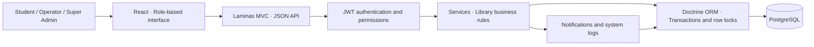
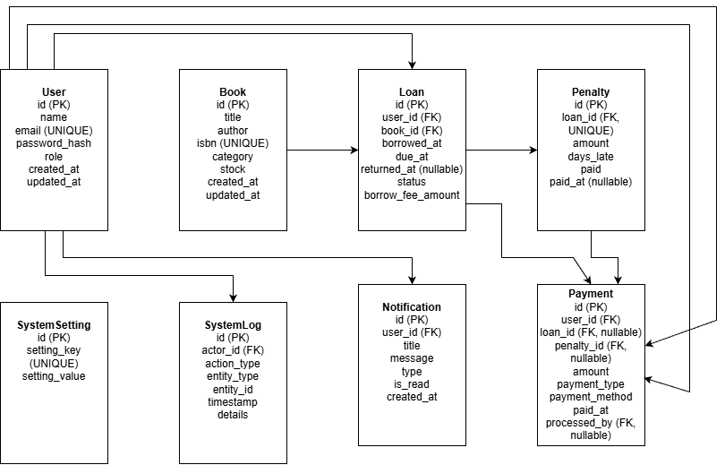

<div align="center">

# Library Management System

### Book Inventory, Borrowing and Penalty Management

**Laminas MVC · Doctrine ORM · PostgreSQL · React**


Developed by **Arila Behrami**

[Overview](#overview) · [Features](#features) · [System Logic](#system-logic) · [Quick Start](#quick-start)

</div>

---

## Overview

This project is a library management application for **Students**, **Operators** and **Super Admins**. It covers the process from finding an available book and recording its borrowing fee to processing its return and settling any overdue penalty.

The backend uses **Laminas MVC** to expose a RESTful JSON API, **Doctrine ORM** for persistence and **PostgreSQL** for storage. The **React** frontend provides separate views for each role, including a searchable catalog, borrowing history, inventory management, notifications and administration.

> **Payments are simulated.** Confirming a borrowing fee or penalty records a successful payment in the database. The application does not connect to a payment gateway or transfer money.

## Features

| Feature | Description |
| :--- | :--- |
| Book catalog | Search by title, author, category or ISBN, filter by category and show only available books. |
| Borrowing | Confirm the current fee, check availability and borrowing restrictions, and create a loan with its due date. |
| Student dashboard | View active loans, due dates, borrowing history and finalized penalties. |
| Inventory management | Add, edit and soft-delete books, with availability derived from the current stock. |
| Returns and penalties | Restore stock when a book is physically returned and calculate any overdue charge. |
| Payment handling | Allow students to settle their penalties or staff to record payments on their behalf. |
| Student history | Let staff open a student's borrowing history and penalty status from the loans table. |
| Account management | Let Super Admin create, update and soft-delete Student and Operator accounts. |
| Adjustable settings | Configure borrowing fees, daily penalties, loan duration and borrowing limits. |
| Notifications | Store account-specific overdue, pending-penalty, low-stock and out-of-stock alerts. |
| System logs | Record borrowing, returns, penalties, inventory changes, account changes and setting updates. |
| Responsive interface | Adapt navigation, catalog cards and management views to desktop and mobile screens. |

## System Architecture



Controllers handle HTTP requests and JSON responses. Services contain the borrowing, return, payment and management logic. Doctrine entities define the stored records and relationships, while migrations manage the database schema. React accesses application data through the API.

## User Roles

| Role | Application access |
| :--- | :--- |
| **Student** | Search books, borrow available copies, view personal loans and history, read notifications and pay personal penalties. |
| **Operator** | Manage books, inspect loans across students, view student history and penalties, process returns, record penalty payments and receive stock alerts. |
| **Super Admin** | Access all Operator features, manage Student and Operator accounts, change system settings and view system logs. |

Authentication uses **JWT bearer tokens**, with a default lifetime of one hour. The API reads the user's current account and role from the database when authenticating requests. Passwords are hashed with **Argon2id**.

## System Logic

### Borrowing a Book

1. The student searches the catalog and selects an available book.
2. The interface displays the configured borrowing fee before confirmation.
3. The backend checks stock, unpaid penalties, overdue restrictions and the student's borrowing limit.
4. A successful transaction decreases stock by one, creates the loan, records the simulated payment and writes a system log.
5. The due date is set to **23:59:59 on the checkout date plus the configured borrowing period**.

An unavailable book returns **HTTP 409** with the code `unavailable`. Existing unpaid penalties block borrowing even after the associated book has been returned. An unreturned overdue book also blocks borrowing when the daily penalty rate is greater than zero.

### Returning a Book

1. The student physically delivers the book to an Operator or Super Admin.
2. Staff confirms the return in the application.
3. Stock increases by one immediately, regardless of whether a penalty remains unpaid.
4. A return on or before the due date closes the loan without a penalty.
5. A late return with a positive penalty rate creates a penalty and leaves the loan in `awaiting_payment` until payment is recorded.

Late days are calculated by **calendar date**, beginning on the day after the due date:

```text
penalty = days_late × daily_penalty_rate

3 days late × €1.00 per day = €3.00
```

The final payable penalty is calculated at return time using the rate configured at that moment. A zero penalty rate allows an overdue return to close without debt. Transactions and row locks protect stock and loan updates; repeated returns and repeated penalty payments are rejected.

### Paying a Penalty

The student can confirm payment from the personal penalties view. Staff can instead record a payment on the student's behalf. Payment marks the penalty as paid and closes its `awaiting_payment` loan. Stock is unchanged at this stage because it was already restored during the physical return.

### Inventory and Notifications

| Condition | Application behavior |
| :--- | :--- |
| Stock above 2 | The book is available for borrowing. |
| Stock of 1 or 2 | The book remains available; staff receive a low-stock notification. |
| Stock of 0 | Students see the book as unavailable; staff receive an out-of-stock notification. |
| Unreturned overdue loan | The student receives an overdue alert when alerts are refreshed. |
| Finalized unpaid penalty | The student receives a pending-penalty reminder when alerts are refreshed. |

Opening **Notifications** refreshes overdue alerts and pending-penalty reminders. For background generation, run the following command daily through cron or Windows Task Scheduler, from `backend`:

```powershell
php bin/mark-overdue.php
```

Scheduling is configured separately; the application does not install a scheduled task automatically.

## Loan Statuses

| Status | Meaning |
| :--- | :--- |
| `active` | The book is checked out and its due date has not passed. |
| `overdue` | The due date has passed and the book has not been returned. |
| `awaiting_payment` | The book is back in stock, but its finalized penalty remains unpaid. |
| `closed` | The book has been returned and no unpaid penalty remains for the loan. |

Loan views identify unreturned overdue books by their due date. The overdue processing script also persists the overdue status and generates alerts.

## System Settings

These values are stored in the database and can be edited only by **Super Admin**. The student catalog reads the current policy from the API.

| Setting | Initial value | Purpose |
| :--- | :--- | :--- |
| `borrow_fee` | **€2.00** | Flat fee recorded for each checkout. |
| `penalty_rate` | **€1.00/day** | Charge for each calendar day overdue. |
| `borrowing_period` | **14 days** | Number of days between checkout and the due date. |
| `borrowing_limit` | **3 books** | Maximum number of books a student may have checked out at once. |

## Data Model

| Entity | Responsibility |
| :--- | :--- |
| `User` | Account details, password hash, role and soft-deletion state. |
| `Book` | Bibliographic details, available stock and soft-deletion state. |
| `Loan` | Student/book relationship, borrowing and return dates, status and recorded borrowing fee. |
| `Penalty` | Finalized amount, days late and payment status for one loan. |
| `Payment` | Payment amount, type, method, payer and optional staff processor. |
| `Notification` | Account-specific message, type and read status. |
| `SystemSetting` | Adjustable library policy values. |
| `SystemLog` | Actor, action, affected entity, timestamp and action details. |

<p align="center">
  
</p>

The ER diagram provides a relationship overview. Doctrine entity mappings and migrations define the implemented schema. Borrow-fee payments reference a loan directly; penalty payments reference a penalty, which links back to its loan.

## Quick Start

The commands below use **PowerShell on Windows**. Install **PHP 8.2 or 8.3**, Composer, PostgreSQL, and Node.js/npm compatible with Vite 8. Enable `pdo_pgsql`, `bcmath` and the other extensions required by Composer. Account creation requires Argon2id support.

### 1. Get the Project

```powershell
git clone https://github.com/arilabehrami/library-management-system.git
cd library-management-system
cd backend
composer install
```

### 2. Configure the Database and Authentication

Start PostgreSQL and create a database named `library_management` using pgAdmin or the PostgreSQL command-line tools. In the backend terminal, set:

```powershell
$env:DB_HOST = "localhost"
$env:DB_PORT = "5432"
$env:DB_NAME = "library_management"
$env:DB_USER = "postgres"
$env:DB_PASSWORD = "your_database_password"
$env:JWT_SECRET = php -r "echo bin2hex(random_bytes(32));"
```

Keep these variables in the terminal used to start the backend. `JWT_SECRET` must contain at least 32 characters. To reuse a configuration across terminal sessions, copy `config/autoload/local.php.dist` to `local.php` and configure its connection and authentication values. Local configuration overrides the global environment defaults and is excluded from Git.

Apply the migrations and create the initial administrator:

```powershell
php vendor/bin/doctrine-module migrations:migrate --no-interaction
php bin/create-admin.php "Library Admin" admin@example.com
```

The administrator command asks for a password of at least eight characters. Input is visible in the terminal. No default account password is shipped with the project.

### 3. Start the Backend

From `backend`, in the same configured terminal:

```powershell
composer serve
```

The API runs at [http://localhost:8080](http://localhost:8080). The default Laminas welcome page at this address is separate from the React application.

### 4. Start the Frontend

In a second terminal, from the project root:

```powershell
cd frontend
npm ci
npm run dev
```

Open [http://localhost:5173](http://localhost:5173), or the Local URL printed by Vite. The development proxy forwards `/api` requests to the backend on port 8080.

### 5. Use the Application

Sign in with the administrator account. Create Student and Operator accounts in **Llogaritë**, then add books in **Librat**. Sign in as a student to test catalog searches and borrowing, and as staff to process returns and payments.

## API

Authenticated requests use `Authorization: Bearer <token>`. Each endpoint applies the relevant account or staff permissions.

| Method | Endpoint | Purpose |
| :--- | :--- | :--- |
| `POST` | `/api/auth/login` | Authenticate and obtain a JWT token. |
| `GET`, `POST` | `/api/books` | Search/list books or create a book. |
| `GET`, `PUT`, `DELETE` | `/api/books/:id` | View, update or soft-delete a book. |
| `POST` | `/api/loans` | Borrow a book using `book_id`. |
| `POST` | `/api/loans/:id/return` | Process the physical return. |
| `POST` | `/api/loans/:id/penalty/pay` | Record payment of a loan's penalty. |
| `GET` | `/api/me/loans` | View personal active loans and the current policy. |
| `GET` | `/api/me/history` | View personal borrowing history. |
| `GET` | `/api/me/penalties` | View personal finalized penalties. |
| `GET` | `/api/operator/loans` | Inspect loans across students, with an optional status filter. |
| `GET` | `/api/operator/users/:id/loans` | View a student's borrowing history. |
| `GET` | `/api/operator/users/:id/penalties` | View a student's penalties. |
| `GET` | `/api/notifications` | Refresh alerts and list the current user's notifications. |
| `POST` | `/api/notifications/:id/read` | Mark a personal notification as read. |
| `GET`, `POST` | `/api/admin/users` | List accounts or create a Student/Operator account. |
| `PUT`, `DELETE` | `/api/admin/users/:id` | Update or soft-delete a managed account. |
| `GET` | `/api/admin/settings` | Read the system settings. |
| `PUT` | `/api/admin/settings/:key` | Update one system setting. |
| `GET` | `/api/admin/logs` | View system logs with optional filters. |

## Project Structure

```text
library-management-system/
├── backend/
│   ├── bin/
│   ├── config/
│   ├── data/doctrine/migrations/
│   ├── module/Application/
│   │   ├── config/
│   │   ├── src/
│   │   │   ├── Controller/
│   │   │   ├── Entity/
│   │   │   └── Service/
│   │   └── test/
│   └── public/
├── docs/
├── frontend/
│   └── src/
│       ├── components/
│       ├── hooks/
│       └── pages/
└── README.md
```

## Code Verification

### Backend Tests

Create a separate PostgreSQL database named `library_management_test`. From `backend`, using the same database credentials as the application:

```powershell
Copy-Item config/autoload/testing.local.php.dist config/autoload/testing.local.php
$env:APP_ENV = "testing"
php vendor/bin/doctrine-module migrations:migrate --no-interaction
php vendor/bin/phpunit --do-not-cache-result
Remove-Item Env:APP_ENV
```

The service tests **truncate tables in the test database** and refuse a database name that does not end in `_test`. Test mode disables configuration caching. Remove `APP_ENV` after testing before starting the normal application.

Tests cover the last available copy, borrowing limits, unpaid-penalty lockout, unreturned overdue books, due-date boundaries, late-day calculations, stock restoration, payment authorization, zero penalty rates and duplicate returns/payments.

### Frontend Checks

From `frontend`:

```powershell
npm run lint
npm run build
```

## Assumptions and Trade-offs

- **Payment simulation:** fees and penalties are recorded locally without external payment processing.
- **Penalty finalization:** the payable amount is finalized when staff receives the physical book. Later changes to the penalty rate do not alter already finalized penalties.
- **Record retention:** books and accounts are soft-deleted to preserve history. Deleted accounts cannot sign in, deleted books cannot be borrowed, and their email addresses or ISBNs remain reserved.
- **Token storage:** JWT tokens are stored in browser localStorage for this take-home application. Expired sessions return to the login screen.
- **Time handling:** PHP web and scheduled processes should use the same timezone so calendar-day calculations remain consistent.
- **Deployment:** the Vite proxy is for development. A production frontend needs an `/api` reverse proxy to Laminas and an SPA fallback to `index.html`.

---
